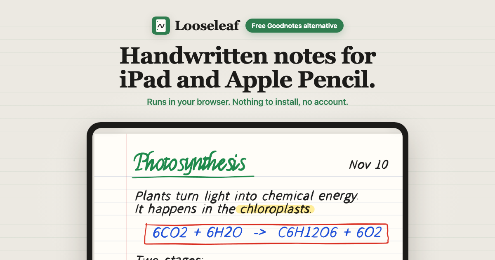
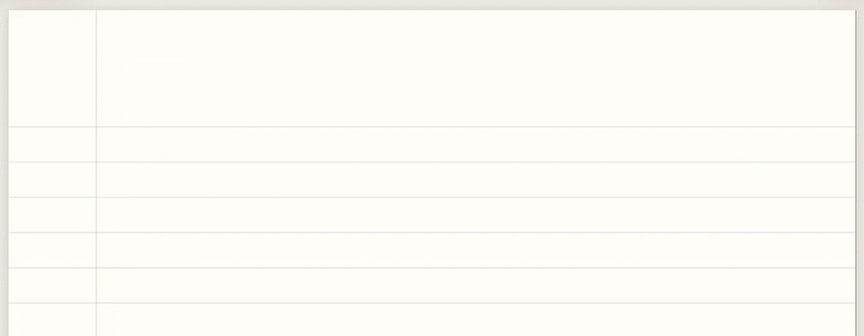
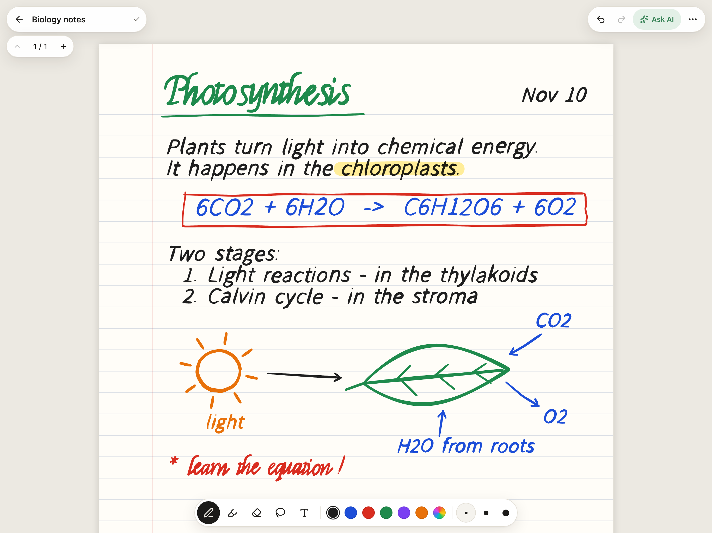
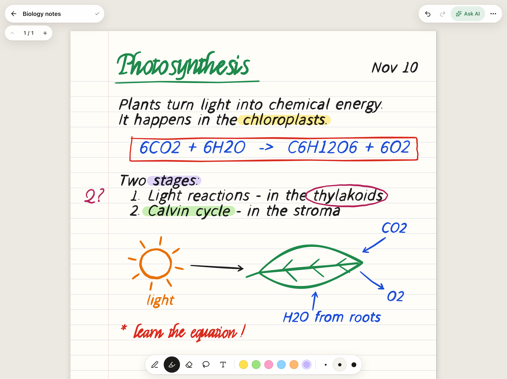
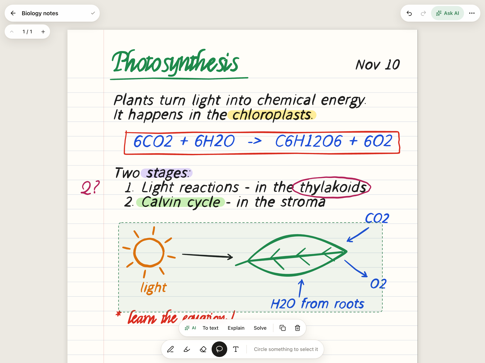
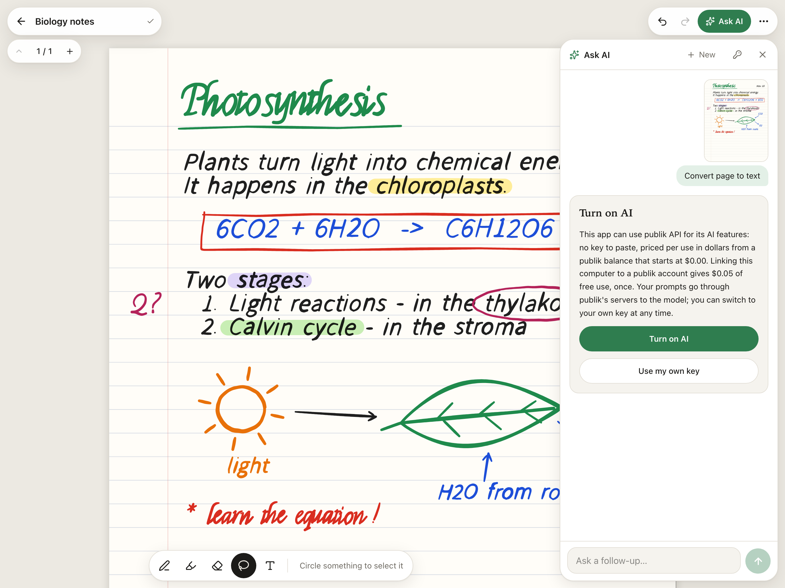
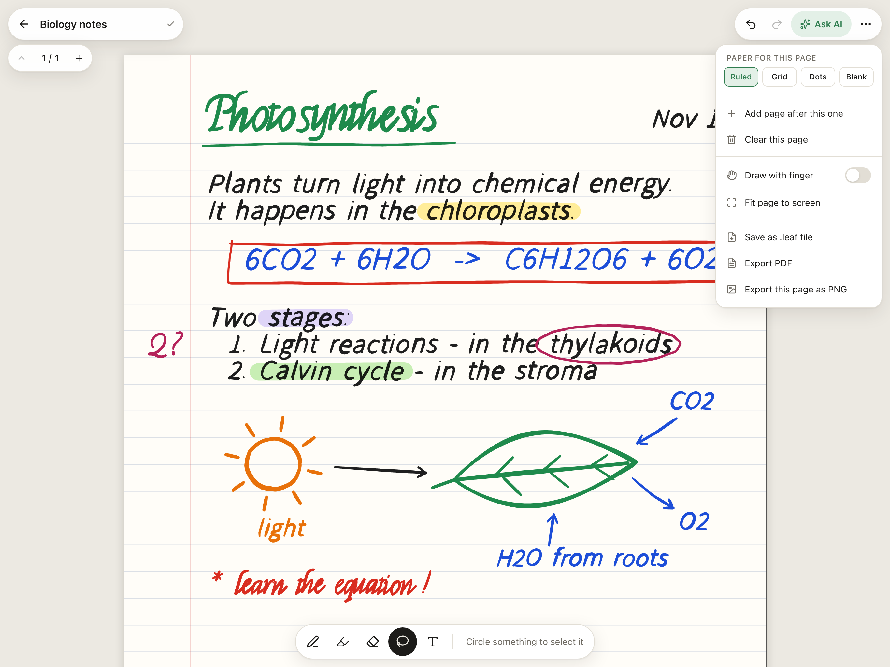
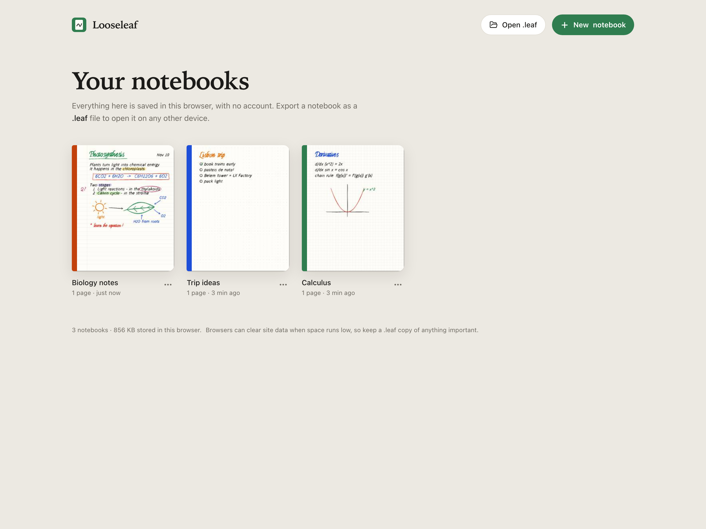

<p align="center">
  
</p>

# Looseleaf

**Handwritten notes for iPad and Apple Pencil, right in the browser. Free, no notebook limit, and your notes stay on your device.**

**[looseleaf-seven-green.vercel.app](https://looseleaf-seven-green.vercel.app)** · the app itself is at **[/app](https://looseleaf-seven-green.vercel.app/app)** · nothing to install · MIT licensed · a free alternative to Goodnotes

<p align="center">
  
</p>
<p align="center"><sub>Ink going into the live app. Strokes are scripted pen input, sped up. All notebook content shown here is sample content.</sub></p>

<table>
  <tr>
    <td width="50%"><br><sub><b>A full page of notes.</b> Pressure ink, highlighter, six pen colours and three thicknesses (sample notes).</sub></td>
    <td width="50%"><br><sub><b>Any colour you want.</b> Presets plus a custom colour per tool, picked with the system colour picker.</sub></td>
  </tr>
  <tr>
    <td><br><sub><b>Lasso to move, copy or delete.</b> Or ask AI to turn the selection into text, explain it or solve it.</sub></td>
    <td><br><sub><b>AI is opt-in.</b> Turn it on with publik API, or paste your own OpenAI or Anthropic key. Shown before any request is made.</sub></td>
  </tr>
  <tr>
    <td><br><sub><b>Pages and paper.</b> Ruled, grid, dots or blank; add pages; export PDF, PNG or a portable <code>.leaf</code> file.</sub></td>
    <td><br><sub><b>Your notebooks, in your browser.</b> No sign-up; everything is stored on the device (sample notebooks).</sub></td>
  </tr>
</table>

## What you get

- **A public page, then the app.** The site's front page explains Looseleaf; **Open Looseleaf** takes you to the app at `/app`, where you sign in with publik and write. There is no Looseleaf account. Notebooks are saved in your browser (IndexedDB).
- **Unlimited notebooks and pages**, no watermark on exports.
- **Import a PDF and write on it.** Lecture slides, handouts, past papers: **Import PDF** in the library (or drop a PDF on it) makes a notebook with one page per PDF page; **Insert PDF pages** in the page menu adds a PDF into the notebook you are in. Pages are prepared on your device (nothing is uploaded), sharp enough to zoom on an iPad, and exported PDFs, `.leaf` files and AI questions all include them. Up to 300 pages and 100 MB per PDF; password-protected PDFs need the password removed first.
- **Portable `.leaf` files.** Export a notebook, open it on any other device. The format is plain JSON (see below).
- **Pencil-first input.** Pressure-sensitive ink, palm rejection, one-finger scroll and pinch zoom once a Pencil is detected. Works with a mouse or finger too. (This is v0.1: the Pencil handling has not had a tuning pass on a real iPad yet, so issues are very welcome.)
- **AI that reads your handwriting.** Lasso some ink and convert it to text, have it explained, or get a maths problem solved. Ask questions about a whole page, make flashcards, get quizzed.
- **Add it to the iPad Home Screen** for a full-screen app; it opens straight into `/app`. Opening it needs a connection, because Sign in with publik checks in each time; your notes themselves never leave the device.

## Compared with Goodnotes

Goodnotes is a polished native app with years of features. Looseleaf is a small, free web app that covers everyday handwritten notes. Here is the honest picture (Goodnotes plans as listed on [goodnotes.com/pricing](https://www.goodnotes.com/pricing), November 2026):

| | Looseleaf | Goodnotes |
|---|---|---|
| Price | Free, open source (MIT) | Free plan; Essential $11.99/year; Pro $35.99/year; one-time Special Edition on Apple devices |
| Free limits | None: unlimited notebooks and pages | Free plan: 3 files, 3 folders, 5 MB imports, watermarked exports |
| Account | Sign in with publik; no Looseleaf account, notes stay in your browser | Goodnotes account for Windows, Android and web libraries and for cloud features |
| Where it runs | Any modern browser: iPad, Mac, PC, Android tablet | Native apps for iPad, iPhone and Mac, plus Android, Windows and web |
| Handwriting | Pressure ink, highlighter, eraser, lasso (move, copy, delete), typed text, custom colours | All of that plus shapes, stickers, tape, elements and more |
| Paper | Ruled, grid, dots, blank | Many paper templates and covers, plus template marketplace |
| PDF import and annotation | Yes: import a PDF (or insert its pages), write and highlight on it, export it back as PDF | Yes |
| Audio recording | No | Yes (20 minutes on the free plan) |
| Handwriting search | No | Yes |
| Sync and collaboration | No cloud; move notebooks with `.leaf` files | Cloud sync; real-time collaboration on Pro |
| Export | PDF, PNG, `.leaf` (JSON), no watermark | PDF and more; watermark on the free plan |
| AI on your notes | Opt-in: pay-per-use via publik API, or your own OpenAI/Anthropic key | Goodnotes AI: limited on the free plan, more with Pro or the AI Pass add-on |
| Where notes live | Only in your browser, unless you export | On device and in Goodnotes cloud |

If you need audio recording, sync or deep PDF tools (links, text selection, searching PDF text) today, Goodnotes does more. If you want a free notebook with no limits that keeps your notes on your device, Looseleaf is for you.

## Run it

```bash
npm install
npm run dev
```

Then open http://localhost:3000 for the landing page, or http://localhost:3000/app for the app. For a production build: `npm run build && npm start`.

## Sign in and privacy

The landing page at `/` is public. The app at `/app` opens with **Sign in with publik**, before its first screen. Your notebooks still live only in your browser; signing in does not upload them anywhere. Notebooks made before 0.1.4, when the app was at `/`, are still there (same site, same browser storage), and old `/#/n/…` notebook links and older Home Screen installs are sent on to `/app`.

To count its users, Looseleaf sends publik two events and nothing else: `app_opened` (once per browser session) and `active_session` (every 30 minutes while a tab is open). Each one carries the app's name and version, your operating system and a random ID for this browser, sent with this browser's publik key. No notes, pages, questions or answers. Browsers with Do Not Track or Global Privacy Control turned on are never counted.

## AI

AI features go through [publik API](https://publikhq.com/developers), so users need no key. After signing in, Looseleaf asks once how to pay for AI: connect your publik plan, or use your own OpenAI or Anthropic **API key**, pasted under the key icon in the AI panel and stored only in that browser. Change your mind any time under the same key icon. ChatGPT and Claude subscriptions are not API keys and cannot be used.

Server environment variables (all optional, but set `PUBLIK_COOKIE_SECRET` on any public deployment):

| Name | Purpose |
|---|---|
| `PUBLIK_APP_TOKEN` | The app's public publik token. Overrides `publik-app-token.txt`. |
| `PUBLIK_COOKIE_SECRET` | Seals each browser's publik key into its cookie. Changing it signs every browser out. |
| `PUBLIK_API_KEY`, `PUBLIK_API_BASE_URL` | `npm run dev` only: one fixed publik key for every request (handy for local testing). Ignored in production. |
| `DO_NOT_TRACK=1` or `PUBLIK_TELEMETRY=off` | Turn usage counting off for the whole server. |
| `PUBLIK_SELF_TEST` | `npm run build && PUBLIK_SELF_TEST=1 npm start` prints `publik self-test: ok looseleaf <version>` and exits. Never set it on a deployment. |

What is sent: only the page image (or the lassoed part) and your question, and only when you ask. Notes are never uploaded otherwise.

## The `.leaf` format

A `.leaf` file is one JSON object. Pages imported from a PDF also carry a `bg` (the page image, its pixel size, fitted to the page width or height and pinned to the top), and the images themselves travel in a top-level `assets` map of data URLs (JPEG, PNG or WebP only, at most 8 MB each). Versions before 0.2 open such a file without the backgrounds.

```jsonc
{
  "format": "looseleaf",
  "version": 1,
  "id": "…", "title": "Physics", "cover": "#2F7D4F",
  "createdAt": 1794300000000, "updatedAt": 1794300000000,
  "pages": [
    {
      "id": "…",
      "paper": "ruled",            // blank | ruled | grid | dots
      "bg": { "kind": "image", "ref": "a1b2c3", "w": 1632, "h": 918 }, // optional: an imported PDF page
      "items": [
        // pts is a flat list of x, y, pressure triples; a page is 816 × 1056 units
        { "id": "…", "type": "stroke", "tool": "pen", "color": "#1F1F1F", "size": 4, "real": true, "pts": [120, 200, 0.4, 121.5, 201, 0.5] },
        { "id": "…", "type": "text", "x": 100, "y": 300, "w": 420, "size": 18, "color": "#1F1F1F", "text": "Typed text" }
      ]
    }
  ],
  "assets": { "a1b2c3": "data:image/jpeg;base64,…" } // optional: page images by ref
}
```

Readers should skip item types they do not know.

## Shortcuts

`P` pen · `H` highlighter · `E` eraser · `L` lasso · `T` text · `⌘Z` / `⇧⌘Z` undo and redo · `⌘D` duplicate selection · `Delete` remove selection · hold `Space` and drag to pan · `⌘`/`Ctrl` + scroll to zoom.

## Not in this version

Audio recording, real-time collaboration, handwriting search, searching or selecting text inside imported PDFs, shape snapping, accounts and cloud sync.

## Stack

Next.js (App Router), TypeScript, Tailwind, [perfect-freehand](https://github.com/steveruizok/perfect-freehand) for stroke geometry, jsPDF for PDF export, [PDF.js](https://mozilla.github.io/pdf.js/) (`pdfjs-dist`, pinned) for PDF import.

MIT licensed.
